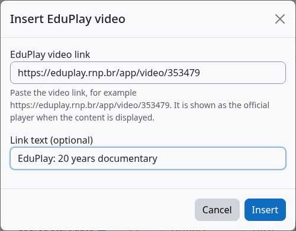

moodle-tiny_eduplay
===================

.. PITCH-BEGIN (generated by workspace/docs/tools/pitch_docs.py; edit there)

**Um botão no editor para pôr um vídeo do EduPlay em qualquer texto do curso.**

   O diálogo do EduPlay no editor do Moodle.

* **Inserir em segundos.** Clique no botão do EduPlay, cole o link, escolha o texto, pronto.
* **Erros são pegos cedo.** Um link errado ou não suportado mantém o diálogo aberto e explica o problema, em vez de deixar um link quebrado no curso.
* **Amigável para todos.** Campos rotulados, erro anunciado a leitores de tela e uso completo pelo teclado.
* **Conteúdo limpo.** Só o link normal do EduPlay é gravado; o player aparece quando a página é exibida.

Veja em 30 segundos
-------------------

.. raw:: html

   <video controls preload="none" style="width:100%;max-width:960px" aria-label="Veja em 30 segundos">
     <source src="https://eduplay-moodle-suite.github.io/media/tiny.pt-br.mp4" type="video/mp4">
     <a href="https://eduplay-moodle-suite.github.io/media/tiny.pt-br.mp4">MP4</a>
   </video>

*Clicar no botão, colar o link, inserir, salvar (interface do Moodle em inglês).*

Comece em três passos
---------------------

1. Instale o ``local_eduplay`` e o ``tiny_eduplay`` (:doc:`installation`).
2. No editor do Moodle, clique no botão **EduPlay** (ou *Inserir* > *Inserir vídeo do EduPlay*).
3. Cole o link e clique em **Inserir**.

Use junto com o ``media_eduplay`` para exibir o link como o player oficial.

.. PITCH-END

O que é
-------

O **moodle-tiny_eduplay** adiciona um botão e um item do menu *Inserir* ao editor TinyMCE do Moodle para inserir vídeos do EduPlay. O autor cola o link do vídeo, o plugin o valida e o link canônico é inserido no conteúdo; o `moodle-media_eduplay <https://eduplay-moodle-suite.github.io/moodle-media_eduplay/>`_ o exibe como o player oficial quando o conteúdo é apresentado. Faz parte da **EduPlay Moodle Suite** (não oficial).

English version: `English <../en/index.html>`_.

.. warning::

   Este projeto não é oficial. Não possui afiliação, endosso ou representação da RNP, do EduPlay ou do Moodle HQ.

.. toctree::
   :maxdepth: 2
   :caption: Conteúdo

   installation
   configuration
   usage

Principais recursos
-------------------

* **Inserção validada**: só links ``https://eduplay.rnp.br/app/video/{id}`` (ou a forma de embed, que é normalizada) são aceitos.
* **Referência canônica**: só o link canônico é gravado no conteúdo, nunca uma URL temporária de mídia.
* **Diálogo acessível**: campos rotulados, mensagem de erro anunciada a tecnologias assistivas e operação por teclado.
* **Moodle 4.5 LTS e 5.3 LTS**.
